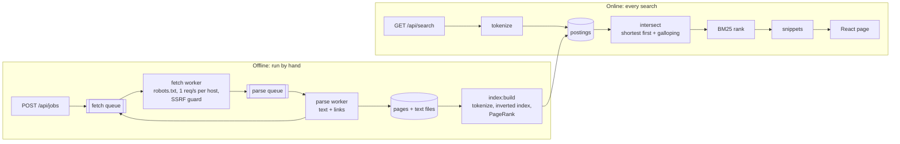

# Mini Search

A small web search engine built from scratch in JavaScript: a polite,
crash-tolerant crawler, an inverted index in MongoDB, BM25 and PageRank
ranking, phrase search, typo correction, highlighted snippets, autocomplete, a React
search page with a public Trending page (rising and most searched queries,
popular reads), and an evaluation that **measures** which ranking actually works.

The corpus is 3,748 pages: 2,884 from Simple English Wikipedia (the ~1,000 core
articles every encyclopedia should have, plus pages around the Main Page) and
856 Medium articles read through RSS. No search library
does the core work: MongoDB `$text`, Atlas Search, Elasticsearch and Lunr are
deliberately not used.

## Results

Evaluated on 25 queries with graded relevance labels (2 / 1 / 0), top 10
results, pages containing all query words:

| Ranking | Precision@10 | nDCG@10 |
|---|---|---|
| **BM25** (default) | **0.644** | **0.884** |
| TF-IDF | 0.536 | 0.723 |
| BM25 + PageRank, α = 0.9 | 0.636 | 0.860 |
| BM25 + PageRank, α = 0.5 | 0.428 | 0.469 |
| PageRank only | 0.192 | 0.170 |

These are lower than the earlier 0.943 on purpose: that score was inflated.
The index held ~640 extra copies of pages (the same Wikipedia article
crawled by several jobs, or reached through a redirect alias), and the
metric counted two copies of a relevant page as two relevant results. Now
the index keeps one document per page and the metric counts a repeated URL
once. 94% of the shown results are labeled; the rest count as not relevant.

**Finding: PageRank made results worse at every mix.** The highest-PageRank
pages here are hubs like *Wikipedia*, *United States* and *Europe*: almost
every page links to them, so they contain most query words, but they are
rarely what a query is about. Per query, the best mix (α = 0.9) beat BM25
on 5 queries, tied on 6 and lost on 14. BM25 alone is therefore the
default; the combined ranking stays available. Full table: [backend/eval/results.md](backend/eval/results.md).

Relevance labels were drafted blind (pooled top-10 of every method, sorted by
title, rank and method hidden) by an AI assistant and should be reviewed;
see [backend/eval/judgments.json](backend/eval/judgments.json).

Other numbers:

| | |
|---|---|
| Crawl | 3,000 pages in two jobs at 1 request/s, 0 failures, 0 dead letters (the second survived DNS and connection drops) |
| Index | 3,748 pages (2,884 Wikipedia, 856 Medium, 8 other), 122,363 terms, 1,557,461 postings, 88,656 links |
| Left out by the indexer | 637 older or alias copies of a page, 107 non-English pages, 29 spam pages (all Medium) |
| PageRank | converges in 67 iterations; matches graphology-metrics to 1e-8 |
| Search latency | 90-160 ms without snippets, 135-260 ms with them, against MongoDB Atlas over a ~100 ms network round trip |
| Autocomplete | trie over ~3,750 page titles, ~0.1 ms per lookup, ~2-3 ms per request |
| Tests | 385, all offline (local mock site + in-memory MongoDB) |

**Crawl-order experiment.** Two 300-page crawls from the same start page
(the Main Page), same limits, only the order of the queue different:

| Order | Core articles among the 300 pages | Speed |
|---|---|---|
| **Most linked-to first** (`order: "inlinks"`) | **122 (40.8%)**: United States, World War II, Medicine, India... | 57-60 pages/min |
| Breadth-first (default) | 50 (16.7%): South America, Tropical cyclone, Symphony... | 56-60 pages/min |

Counting how many already-crawled pages link to a waiting URL, and crawling
the most-voted URL first, collects 2.4× more of the ~1,000 core articles on
the same page budget. (Core articles = Simple Wikipedia's "List of articles
all languages should have".)

## How it works



**Crawler** (`backend/crawler/`). Jobs are created through an API; separate
fetch and parse workers take work from queues stored in MongoDB. A worker
*leases* a message (it becomes invisible for 2 minutes); if the worker
crashes, the lease expires and another worker finishes the job. Every step
is idempotent (content-addressed files, conditional state transitions,
upserts), so a repeated delivery changes nothing. It obeys robots.txt,
waits at least 1 s per host across all workers, retries with exponential
backoff and jitter, deduplicates URLs and identical content, and refuses
private/loopback/metadata addresses, checking the exact IP each socket
connects to (DNS-rebinding safe).

Three improvements taken from the standard interview design of a crawler:
**priority crawling** (optional `order: "inlinks"`: each crawled page that
links to a waiting URL raises its priority by 1); **politeness without
sleeping workers** (if a site's next slot is more than 3 s away, the message
goes back to the queue, due at that slot, and the worker takes other work);
and **re-crawl with conditional requests** (`POST /api/jobs/:id/refresh`
sends back `If-Modified-Since` / `If-None-Match`; an unchanged page answers
`304` with no body and is not parsed again, verified against Wikipedia).

**Medium through RSS** (`backend/crawler/rss/`). Medium answers crawlers
with `403 Forbidden` on article pages, and this crawler does not pretend to be
a browser. Medium's public RSS feeds are the door it opens for automated
readers: tag feeds (`/feed/tag/<tag>`) reveal authors, and author or
publication feeds (`/feed/@author`) carry recent articles with full text.
`npm run import:medium` collects them politely (robots.txt, honest
User-Agent, one request every 5 s) and stores each article like a crawled
page, so indexing, snippets and search work unchanged. The first run, at
1 request/s, got `429 Too Many Requests` after ~25 feeds; the importer now
honors `Retry-After`, backs off, and stops the whole import if it is still
refused. At 5 s it imported 1,000 articles from 172 feeds with no 429.

**Search logs and the Trending page** (`server/lib/trends.js`, `/trending`).
Every results page shown is logged (query, result count, time, page) with the
clicks made on it. The browser sends its own id for each view and the server
upserts by it, so a request sent twice is logged once (an idempotency key,
like the crawler's queue handlers). The log is written after the response,
so searching never waits for it. No IP, user id or cookie is stored, and a
TTL index deletes logs after 30 days. Visitors see three lists: **trending
now** (searched at least twice in 24 h and more than the daily average of the
7 days before; growth = (today + 1) / (daily average before + 1)), **most
searched** (7 days), and **popular reads** (most opened results). A query is
only shown after 2 searches that found results, so one-off private text never
appears, and popular reads only include pages of our own index (click URLs
come from the browser and could be faked). Site-health metrics (CTR, CTR by
position, zero-result rate, latency) are implemented and unit-tested in
`server/lib/analytics.js` but deliberately not served: they are for an admin
page behind a login, not for visitors.

**UI.** A React page laid out like a real results page: each result shows the
site's icon (loaded from the site itself, letter fallback), site name and
breadcrumb URL, a blue title link (purple once visited) and a snippet with the
query words in bold. All / Wikipedia / Medium tabs with real counts,
light/dark theme, `/` to focus the search box, preferences (new tab, show
scores, ranking, match mode). Plain CSS, no UI framework.

**Quality filter** (`backend/indexer/quality.js`). The indexer leaves out
pages that would hurt results, without deleting them (`--keep-all` brings
them back): **non-English pages** (our stemmer and stopwords are English),
detected by comparing English function words with those of six other
Latin-script languages plus a non-Latin-letter check, and **spam titles**
("Earn $50-$200 a Day", "Marketing Agency in Chicago", "Review: Can This
Tool…"). Thresholds were measured on the real corpus: a plain "enough
English stopwords" rule would have dropped ~320 Wikipedia tables and lists,
so the test is relative. Result: 0 Wikipedia pages and 136 Medium pages
left out, every one checked by hand. It also keeps **one document per page**:
the newest crawl of a URL, and a redirect alias (`/wiki/MLK`) merged into the
page its `<link rel="canonical">` names (same host only). Links to an alias
still count for the article's PageRank.

**Indexer** (`backend/indexer/`, `backend/shared/tokenize.js`). One shared
tokenizer (case and accent folding, stopwords, Porter stemming, word
positions) for both the index and queries. The index (term → postings
sorted by docId) is built into staging collections and swapped in at the
end, so a failed build never breaks search. PageRank runs over the crawled
link graph by power iteration (d = 0.85, dangling pages handled).

**Search** (`backend/server/lib/`). One database round trip loads the
postings of the query words; document lengths, titles and PageRank come
from an in-memory cache. AND queries intersect postings lists shortest
first, galloping through long lists (48 vs 1,519 comparisons in the test
case). Results are scored with BM25 (k1 = 1.2, b = 0.75), and snippets show
the 30-word window containing the most different query words.

**Phrases and typos** (`backend/server/lib/phrase.js`, `spell.js`).
`"new york"` must match the words next to each other: the stored word
positions are checked after intersection (new at p, york at p + 1). A word
that appears on no page is replaced by the closest real word by edit
distance (Damerau-Levenshtein, max 1-2 edits, same first letter, the more
common word wins ties): "frnce revolution" shows results for "france
revolution", with a link to search exactly what was typed.

**Autocomplete** (`backend/server/lib/trie.js`). A trie of all page titles,
built in memory when the server starts; every node keeps its top 8
completions, so a suggestion is "walk the typed letters, read the list".
Suggestions are ordered by PageRank: wrong for ranking results here, right
for guessing which page someone means after typing "un".

## Run it

Needs Node 20+ and MongoDB (local, or a free Atlas cluster).

```bash
# 1. Backend
cd backend
cp .env.example .env      # set MONGODB_URI and CRAWLER_USER_AGENT (with your contact email)
npm install
npm test                  # 385 tests, no internet needed

# 2. Crawl (three terminals)
npm run dev               # API on http://localhost:3000
npm run worker:fetch
npm run worker:parse
curl -X POST http://localhost:3000/api/jobs -H "content-type: application/json" \
     --data @eval/core-articles-crawl-job.json    # ~1,000 core articles, ~20 min
curl -X POST http://localhost:3000/api/jobs -H "content-type: application/json" \
     --data @eval/wikipedia-crawl-job.json        # optional: ~2,000 more pages, ~1 hour

# 3. Index and evaluate
npm run import:medium     # optional: ~1,000 Medium articles via RSS, a few minutes
npm run index:wiki        # index:build with the Wikipedia settings (skips non-article pages)
npm run eval              # writes eval/results.md

# 4. Search page
cd ../client
npm install
npm run dev               # http://localhost:5173 (proxies /api to :3000)
```

## API

| Endpoint | Purpose |
|---|---|
| `GET /api/suggest?q=&limit=` | Autocomplete: page titles completing the typed text (any word of a title) |
| `GET /api/search?q=&page=&limit=&rank=&mode=&alpha=&correct=&source=&sid=` | Search. `q` may contain `"quoted phrases"`. `rank`: `bm25` (default), `combined`, `tfidf`, `pagerank`, `none`. `mode`: `all` (AND, default) or `any` (OR). `correct=false` turns typo correction off. `source`: `all`, `wikipedia`, `medium`. `sid`: the browser's id for this view (analytics; logged once per id) |
| `POST /api/click` `{searchId, position, url}` | Record a click on a result (sent with `navigator.sendBeacon`) |
| `GET /api/trends` | Public Trending page: queries rising in the last 24 h, most searched queries (7 days), most opened results. Only queries searched at least twice that found results |
| `POST /api/jobs` | Create a crawl job: seeds and limits (depth, pages, pages per host, timeouts, exclude patterns, `order`: `bfs` or `inlinks`...) |
| `POST /api/jobs/:id/refresh` | Re-crawl pages fetched more than `olderThanDays` ago, with conditional requests |
| `GET /api/jobs/:id`, `/stats`, `/failures` | Progress, counters, dead-lettered URLs |
| `POST /api/jobs/:id/pause \| resume \| cancel`, `/failures/retry` | Control a job |
| `GET /api/pages?jobId=&q=`, `GET /api/pages/:id` | Browse crawled pages and their extracted text |
| `GET /api/index/stats`, `GET /api/index/terms/:word` | Inspect the inverted index |
| `GET /api/health` | Liveness, plus DB and storage readiness |

## Design decisions

| Decision | Why |
|---|---|
| Offline crawl + index, online search | Heavy work happens once; a query only reads a few postings lists |
| Queue in MongoDB with leases, at-least-once delivery | Crash recovery without extra infrastructure; handlers are idempotent instead of "exactly once" |
| Follow-up work before ack | A crash between the two repeats a step; it never loses one |
| Politeness and budgets as single atomic MongoDB updates | Several worker processes share the 1 req/s rule and page limits without races |
| SSRF check inside the socket's DNS lookup | No gap between "checked" and "connected" |
| Postings sorted by docId | Two-pointer intersection in O(m + n); galloping when one list is much shorter |
| Small hot data cached in the API process | 1 database round trip per query instead of 4 |
| Ranking chosen by evaluation | BM25 beat every BM25 + PageRank mix on this corpus |

## Scaling: back-of-envelope

Measured here: 192 KB of HTML, 458 postings and ~27 KB of index per page;
~13 database round trips per crawled page. Politeness (1 request/s per site)
caps one site at 86,400 pages/day, which is why this single-site crawl gains
nothing from more workers.

For 10 billion pages in 5 days (a common interview target): ≈ 23,000 pages/s,
which means crawling ≥ 23,000 sites at once; ≈ 35 Gbps of HTML; ≈ 1.9 PB raw
HTML; ≈ 4.6 trillion postings (≈ 270 TB uncompressed index, so compressed and
sharded by document); ≈ 300,000 database operations/s. In this design the
first things to break would be the per-page database round trips, the
MongoDB-based politeness store, the full index rebuild and the in-memory
document cache, in that order.

## Known limitations

- English-only stopwords and stemmer.
- Typo correction only fixes words that appear on no page: "teh" occurs once
  in the corpus, so "teh roman empire" is not corrected. First letters are never corrected.
- Phrases check word positions, not stopwords: "united states of america"
  also matches "united states and america".
- Autocomplete only completes page titles (not arbitrary words), and only from the start of a word.
- It only finds what it crawled: ~3,750 pages. Core topics are covered (India,
  Cricket, Dog, Water...), but anything outside them (e.g. Virat Kohli,
  Bollywood, Google) has no page of its own.
- Duplicates are merged by URL and canonical URL only. Two different URLs
  with nearly the same text and no shared canonical (e.g. a Medium author
  posting one story twice) are still two documents; near-duplicate detection
  (SimHash/MinHash) would catch them.
- The quality filter is a heuristic tuned for precision: some spam gets
  through (e.g. agency blog posts with neutral titles), and pages under 80
  words are never judged on language.
- Workers poll MongoDB; politeness uses worker clocks (fine on one machine).
- Queue priority is global: while an `inlinks` job has work, its messages
  (priority ≥ 1) are always taken before a `bfs` job's (priority 0). A fair
  scheduler would alternate between jobs.
- 6% of the evaluated top-10 results are unlabeled (new Medium and
  experiment pages); `npm run eval:pool` lists them for labeling.

## Project structure

```
backend/
  crawler/    crawl jobs, queues, workers, fetcher, robots.txt, SSRF guard
  indexer/    buildIndex.js (inverted index), pagerank.js
  shared/     tokenize.js: the one text pipeline
  server/     Express API; lib/ = intersect, bm25, combine, snippet, phrase, spell, trie, search
  eval/       queries, relevance labels, metrics, evaluate.js, results.md
  tests/      385 tests (node:test)
client/       React + Vite search page and /trending
```
